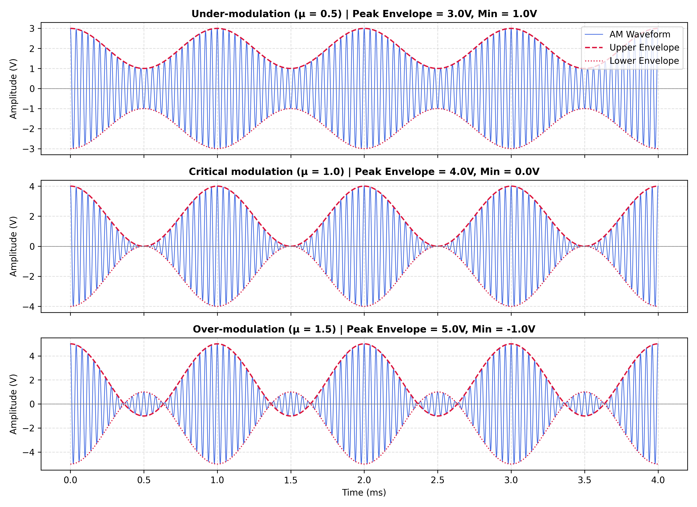
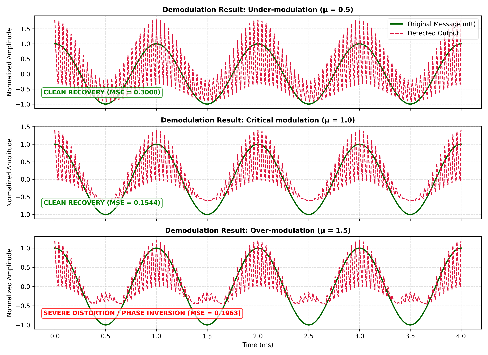
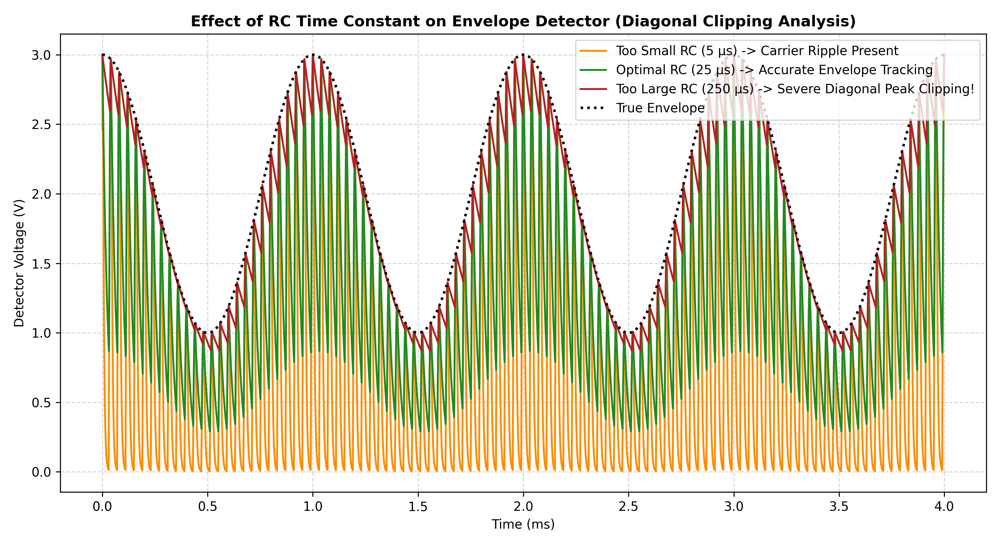
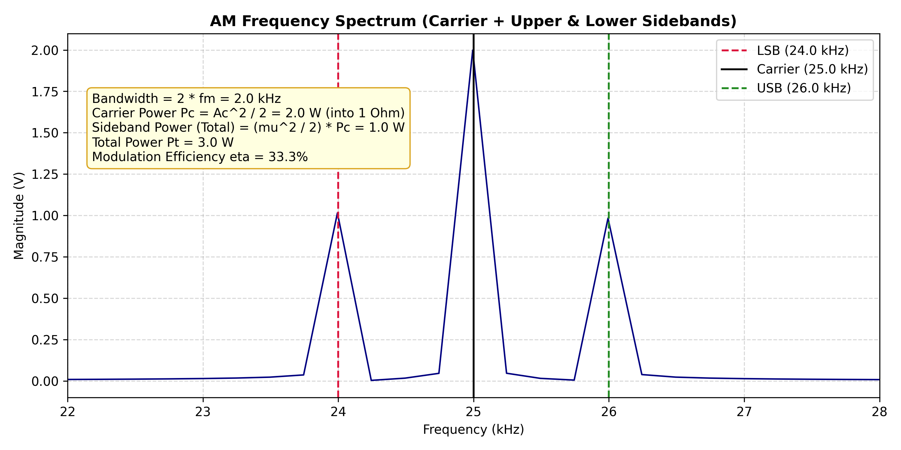

# Amplitude Modulation (AM) Generation and Envelope Detection Simulation

A Python simulation of Amplitude Modulation (AM-DSB-FC) and physical diode-RC envelope detection across under-modulation ($\mu < 1$), critical modulation ($\mu = 1$), and over-modulation ($\mu > 1$), including an analysis of diagonal peak clipping.

---

## 1. Overview & Theoretical Foundations

In standard Amplitude Modulation (Double Sideband Full Carrier - DSB-FC), the amplitude of a high-frequency carrier wave is varied linearly in accordance with the baseband message signal:

$$s(t) = A_c [1 + \mu \cdot m_n(t)] \cos(2\pi f_c t)$$

Where:
- $A_c$ = Carrier amplitude
- $f_c$ = Carrier frequency ($f_c \gg f_m$)
- $m_n(t) = \cos(2\pi f_m t)$ = Normalized message signal
- $\mu = \frac{A_m}{A_c}$ = **Modulation Index**

### Power Distribution and Efficiency
Total transmitted power is distributed between the unmodulated carrier and the information-bearing sidebands:

$$P_t = P_c \left(1 + \frac{\mu^2}{2}\right)$$

The modulation efficiency $\eta$ is:

$$\eta = \frac{P_{\text{sidebands}}}{P_t} = \frac{\mu^2}{2 + \mu^2}$$

At maximum linear modulation ($\mu = 1$), efficiency reaches its upper limit of **$33.3\%$**, meaning two-thirds of the transmitted power remains in the unmodulated carrier.

---

## 2. Modulation Conditions

| Condition | Index ($\mu$) | Envelope Behavior | Demodulation Result |
| :--- | :---: | :--- | :--- |
| **Under-modulation** | $\mu < 1$ (e.g., $0.5$) | Envelope never crosses zero ($A_{\min} > 0$) | **Clean, distortion-free** recovery with simple envelope detector |
| **Critical modulation** | $\mu = 1.0$ | Envelope touches zero ($A_{\min} = 0$) | Clean recovery, achieves maximum power efficiency ($33.3\%$) |
| **Over-modulation** | $\mu > 1$ (e.g., $1.5$) | Envelope crosses zero ($A_{\min} < 0$), causing $180^\circ$ phase reversal | **Severe distortion** (rectification clipping) in standard envelope detector |

---

## 3. Simulation Results

### A. Time-Domain Waveforms ($\mu = 0.5$ vs $\mu = 1.0$ vs $\mu = 1.5$)
Shows the carrier modulated across the three test cases alongside upper and lower envelopes:



---

### B. Envelope Detector Demodulation Comparison
Demonstrates the recovered message versus the original message. While $\mu = 0.5$ and $\mu = 1.0$ yield clean reconstructions, $\mu = 1.5$ produces severe clipping distortion due to envelope zero-crossing:



---

### C. Diagonal Clipping & RC Time Constant Selection
The diode-RC envelope detector relies on an optimal discharging rate. The condition to prevent **diagonal peak clipping** is:

$$RC \le \frac{\sqrt{1 - \mu^2}}{\mu \cdot \omega_m}$$

- **Too small $RC$ ($5\ \mu\text{s}$):** Fails to filter out the high-frequency carrier ripple.
- **Optimal $RC$ ($25\ \mu\text{s}$):** Accurately tracks the downward trajectory of the envelope.
- **Too large $RC$ ($250\ \mu\text{s}$):** Capacitor discharges slower than the envelope fall rate, resulting in severe diagonal clipping.



---

### D. Frequency Spectrum (Carrier & Sidebands)
Illustrates the carrier at $f_c$ flanked by the Upper Sideband (USB) at $f_c + f_m$ and Lower Sideband (LSB) at $f_c - f_m$, confirming the transmission bandwidth $B_T = 2 f_m$:



---

## 4. Repository Structure

```text
AM-Modulation-Envelope-Detection/
├── assets/
│   ├── am_frequency_spectrum.png
│   ├── am_time_domain_cases.png
│   ├── diagonal_clipping_effect.png
│   └── envelope_detection_comparison.png
├── src/
│   └── am_envelope_detection.py
├── .gitignore
├── requirements.txt
└── README.md
```

---

## 5. Getting Started

### Prerequisites
- Python 3.8+
- NumPy, SciPy, Matplotlib

### Installation
```bash
git clone https://github.com/Sandeep1-prog/AM-Modulation-Envelope-Detection.git
cd AM-Modulation-Envelope-Detection
pip install -r requirements.txt
```

### Run Simulation
```bash
python src/am_envelope_detection.py
```
All output figures are automatically saved to the `assets/` directory.
